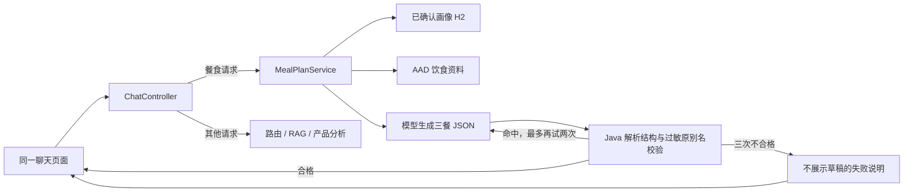

# Day 7～9：餐食护栏与完整演示（2026-11-02）

## 可运行的请求链

`ChatController.chat` 先校验用户、会话和消息。常见餐食请求进入 `MealPlanService.plan`，不交给普通聊天模型自由生成；非餐食请求仍走 Day 1～6 的原路径。餐食服务只读 `ProfileService.find` 的用户已确认画像，缺少画像直接要求先确认。它从本地知识目录精确取出经核对的 AAD 饮食条目，将“饮食与痤疮证据不一致”放入提示词和最终说明；这条来源不证明任何具体食谱的治疗效果。

模型只输出 `MealDraft` 的三餐 JSON。Java 检查必须有早餐、午餐、晚餐及逐项食材。`MealAllergenValidator` 根据已确认画像将“海鲜”展开成虾、蟹、鱼、贝类等已建模组，再检查结构化食材字段的名称与常见别名。例如“海鲜”画像遇到“清蒸虾仁”，或“peanut”画像遇到“花生酱 10g”，都会拒绝。它不扫描整段自然语言来猜测过敏史。展示层只输出通过校验的食材列表；模型返回的做法描述不直接展示。

首次违规后，把命中的**具体餐次、食材、过敏原**反馈给下一轮模型；最多额外重试两次。三次仍违规、JSON 无法解析或结构无效，均不给出草稿。日志记录路由、固定来源 ID、尝试次数、`PASS/REJECT/ERROR`、命中数量和耗时，不记录完整餐食草稿。

## 本地演示

在项目根目录设置 `SKINCARE_LLM_API_KEY`，运行 `mvn spring-boot:run`，打开 `http://localhost:8080/`。仅使用虚构用户。

1. 在画像区填写虚构用户 `meal-demo`，肤质任意，已确认过敏原填 `海鲜, 花生`，勾选确认并保存。
2. 在聊天区问“给我一日三餐建议，注意我已登记的过敏原”。如果模型给出合规草稿，会出现三餐、`MEAL_PLAN` 路由和 AAD 来源；如三次未通过校验，只出现失败说明。
3. 换一个未保存画像的虚构用户再问相同问题，应要求先保存确认画像，不生成餐食。

固定违规样例在 `MealPlanServiceTest` 和 `MealAllergenValidatorTest` 中：第一轮“清蒸虾仁”后改为“鸡胸肉”只能展示后者；三轮“花生酱”只能返回失败说明。`mvn verify` 运行全部测试。真实模型端到端测试使用 H2 内存数据库和虚构画像，不产生真实用户记录。

## 项目取舍和面试讲解

- **路由与护栏分工**：路由识别常见餐食请求；即使模型承诺避开过敏原，也必须由 Java 校验结构化食材。`@Tool` 查询画像与这道业务校验不是同一机制。
- **记忆与画像分工**：聊天中的“我可能过敏”不会写入 H2；餐食校验只看主动确认的画像。会话记忆只保留当前进程内的上下文。
- **RAG 的边界**：AAD 来源只支持饮食证据不确定的解释，不是具体餐次的营养学或治疗依据。知识库仍小，未做营养平衡、能量或特殊人群饮食设计。
- **风险边界**：当前名称和别名词表有限，复合加工食品的隐藏配料、交叉接触与现实过敏史不能被可靠排除。没有登录认证，仅用虚构用户演示；不能称为医疗级安全系统。
- **保守降级**：结构解析失败或三次校验失败时不输出违规草稿。未来可扩充经核实的食材字典与包装过敏原数据，并用独立评测集检验召回率，但本项目不声称已有准确率或 100% 安全。

面试时可沿 `ChatController → MealPlanService → MealDraftGenerator → MealAllergenValidator → ChatResponse` 讲一次请求，再用“虾仁被拦截、第二轮改为鸡胸肉”和“三轮花生酱导致失败”说明：模型负责生成候选，Java 决定候选能否交付。
