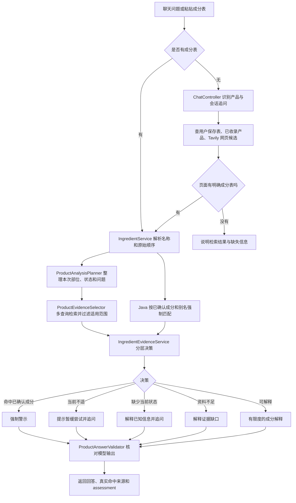

# 产品问答的实际工作流

当前版本用 Java 编排一条有分支的工作流，不依赖多 Agent 或知识图谱。每个节点都有可检查的输入和结果，模型只负责解释，不负责决定是否命中已确认过敏成分。

## 数据边界

- `ProductSearchService` 使用服务端 Tavily 密钥寻找产品网页；网页候选不是已经核实的包装配方。`OfficialIngredientService` 只读页面明确标注的列表，不能从搜索摘要拼接成分。市场、SKU 和配方修订版本不能互相替代。
- `IngredientNames` 保留原始名称、顺序并用小型别名表标准化。未知成分仍是未知，不猜测别名或准确浓度。
- `ProductAnalysisPlanner` 读取本次输入；从“现在泛红”等明确自述推得的状态只在本次分析中使用，不写入画像。已确认画像由 `ProfileService` 单独读取。
- `ProductEvidenceSelector` 可以对问题、刺激/过敏、香精等主题分别检索本地知识库，并在模型之前过滤人群和适用范围。AAD 专业资料、具体体外论文和博主观点有不同证据性质；当前知识条目少，没有相关依据时必须保留缺口。此节点目前不会对任意成分自动联网搜论文。
- `IngredientEvidenceService` 的 `AVOID_CONFIRMED_MATCH`、`PAUSE_DURING_DISCOMFORT`、`ASK_CURRENT_STATE`、`EVIDENCE_GAP`、`EXPLAIN_WITH_LIMITS` 是流程决策，不是诊断或产品安全评级。没有一个状态表示“保证适合敏感肌”。
- `ProductAnswerValidator` 拒绝虚构来源编号和绝对安全承诺；Java 再强制加上过敏警示、当前不适提示或关键追问。模型不能覆盖这些结果。引用链接来自实际检索结果。

## 运行配置

`SKINCARE_SEARCH_API_KEY` 用于产品网页搜索；`SKINCARE_LLM_API_KEY` 用于自然语言解释。两者都由服务端环境变量读取。没有前者时仍可分析用户粘贴的成分表；没有后者时保留 Java 判断与明确的能力不足说明。
